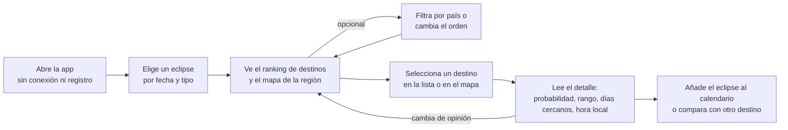
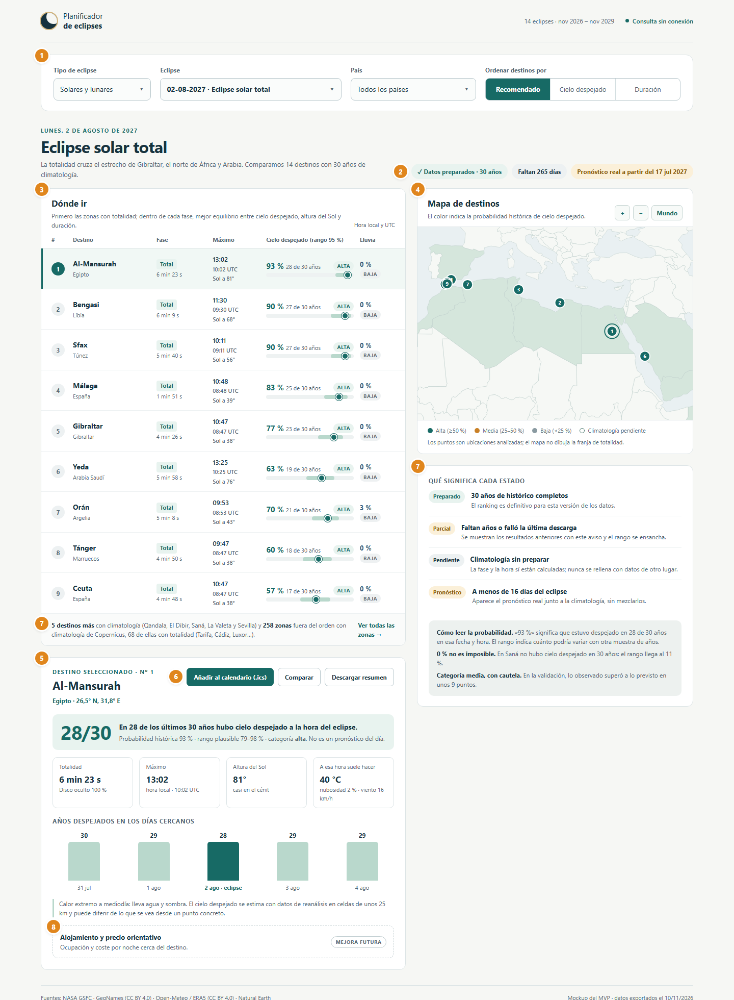
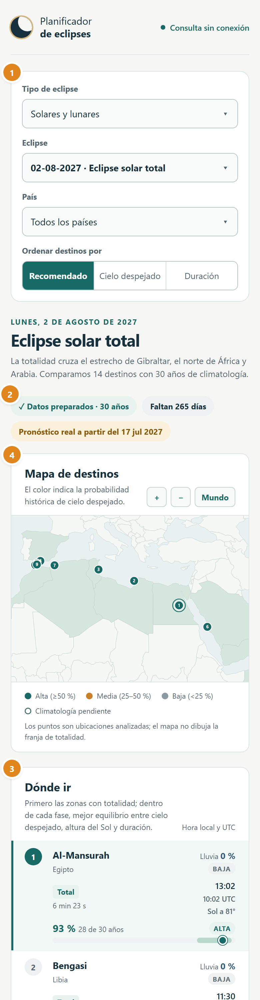
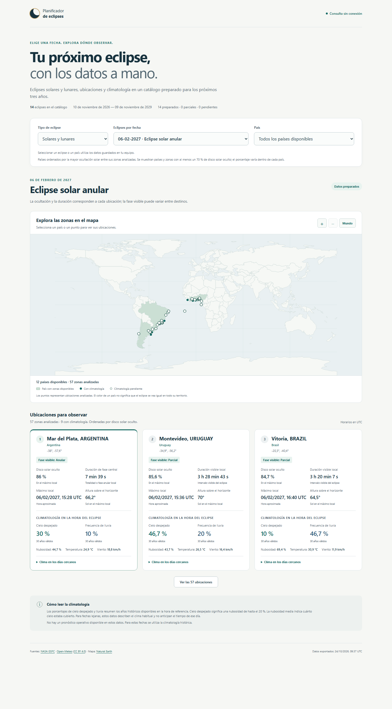
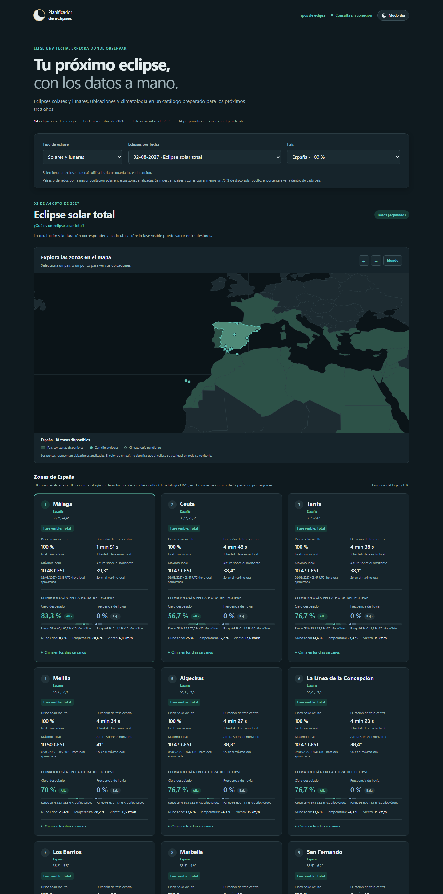
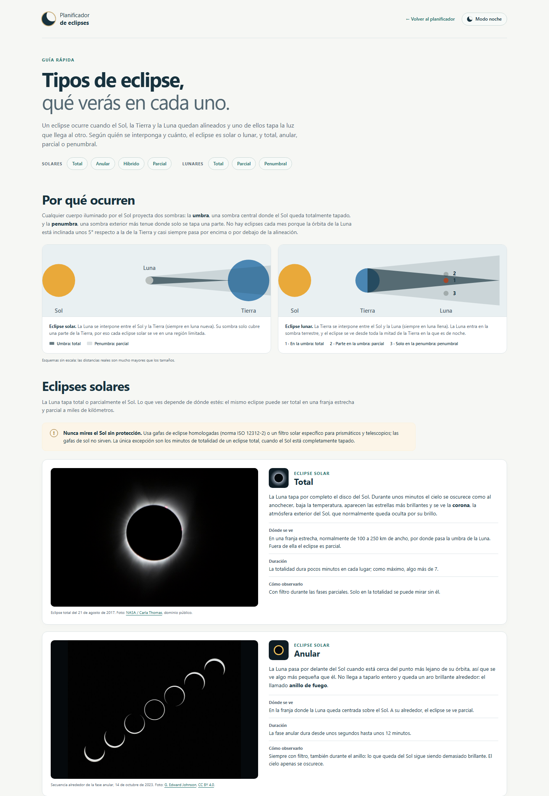
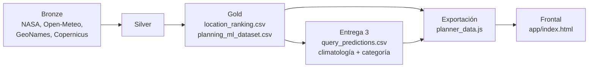

# Diseño del frontal y experiencia de usuario — Planificador geoespacial de eclipses

Esta entrega diseña la pantalla principal del MVP a partir de lo que ya existe: el selector local de `app/`, los datos Gold de la [entrega 2](02_datos_y_preparacion.md) y la decisión de la [entrega 3](03_machine_learning.md) de usar la climatología histórica como estimación, con su categoría y su intervalo.

**Mockup:** [`04_diseno_frontal_ux/mockup.html`](04_diseno_frontal_ux/mockup.html) es una maqueta estática en HTML con datos reales del eclipse solar total del **2 de agosto de 2027** (climatología 1997–2026). Se abre en el navegador sin servidor; con `?limpio` al final de la dirección se ocultan las anotaciones. Las imágenes de este documento son capturas de ese archivo.

## 1. Utilidad y valor del producto

**Usuario.** Aficionados a la astronomía, fotógrafos y grupos o asociaciones que preparan un viaje para ver un eclipse, normalmente con meses o años de antelación.

**Problema.** Para decidir adónde ir hay que cruzar mapas de visibilidad, circunstancias locales (fase, duración, hora, altura del astro) y meteorología histórica, que están en fuentes distintas y no se comparan entre sí. El riesgo principal de un viaje de eclipse es llegar a un lugar donde sí se ve, pero está nublado.

**Qué podrá decidir el usuario.** **A qué destino viajar** para un eclipse concreto y con qué expectativa realista de cielo despejado, sabiendo qué verá (totalidad o parcial, cuánto dura, a qué hora y a qué altura) y cuánta incertidumbre tiene esa estimación.

**Funcionalidades esenciales del MVP.**

| Funcionalidad | Valor para el usuario |
|---|---|
| Elegir un eclipse de los próximos tres años | Ver solo lo que se puede planificar ahora |
| Ranking de destinos con fase, duración, hora y probabilidad de cielo despejado | Comparar opciones en una sola vista en lugar de cruzar fuentes |
| Probabilidad histórica con **categoría** (baja / media / alta) y **rango al 95 %** | Saber cuánto fiarse de la cifra, no solo la cifra |
| Mapa regional coloreado por probabilidad | Ver de un vistazo qué zonas son más prometedoras y dónde están |
| Detalle del destino y exportación al calendario | Pasar de la comparación a la acción |

## 2. Flujo de usuario

El flujo principal tiene **tres pasos y ninguna pantalla intermedia**: todo ocurre en la misma página y cada selección actualiza el contenido de debajo.

| Paso | Qué introduce o selecciona | Qué recibe |
|---|---|---|
| 1. Acceso | Nada: abre `app/index.html` | El catálogo de eclipses de la ventana [hoy, hoy + 3 años) con su estado |
| 2. Elegir eclipse | Tipo (solar o lunar) y fecha | Título, estado de los datos, días que faltan y cuándo habrá pronóstico real |
| 3. Comparar | Opcionalmente, país y criterio de orden | Ranking de destinos y mapa con los mismos números |
| 4. Elegir destino | Un clic en una fila o en un punto del mapa | Detalle con la probabilidad explicada en lenguaje natural, el rango y los días cercanos |
| 5. Después | «Añadir al calendario» | Un archivo `.ics` con la hora local del máximo en ese destino |

Se ha descartado a propósito un formulario inicial («¿desde dónde viajas?», «¿qué presupuesto tienes?»): obliga a responder antes de ver ningún resultado, y el MVP no dispone todavía de datos de transporte ni de precios para aprovechar esas respuestas.

## 3. Diseño del frontal

### Pantalla principal (escritorio)

Los números en ámbar señalan las decisiones que se justifican en el apartado 4:

1. **Selector** de tipo, eclipse y país, con un control de **orden** (recomendado, cielo despejado o duración).
2. **Estado del evento:** datos preparados, días que faltan y desde cuándo habrá pronóstico real.
3. **Ranking «Dónde ir»:** una fila por destino con fase, duración, hora local y UTC, altura del Sol, probabilidad de cielo despejado con su rango y lluvia.
4. **Mapa regional** con los destinos numerados como en el ranking y coloreados por categoría de cielo despejado.
5. **Detalle del destino** seleccionado: la cifra principal expresada como «28 de 30 años», los datos del eclipse y los días cercanos.
6. **Acciones:** añadir al calendario, comparar y descargar el resumen.
7. **Resultados inciertos:** zonas pendientes y significado de cada estado y de las cifras extremas.
8. **Hueco reservado** para alojamiento y precio, marcado como mejora futura.

### Pantalla en el móvil

En el móvil el contenido pasa a una columna, en este orden: selector, estado, mapa, ranking y detalle. Cada fila del ranking se convierte en una tarjeta compacta que mantiene la misma información.

### Punto de partida: la aplicación actual

Esta captura es la aplicación de partida, antes del mockup. La siguiente muestra la aplicación actual en modo noche, filtrada por España para el eclipse del 2 de agosto de 2027, con las zonas en totalidad que se calculan a partir de GeoNames, la hora local y el rango al 95 % de cada probabilidad:

La aplicación de partida cubría el selector, el mapa y las tarjetas por ubicación. El mockup corrige cuatro problemas detectados al usarla; los dos últimos ya están resueltos en la aplicación:

- **Orden de los destinos.** Ahora se ordenan solo por disco solar oculto. En el eclipse del 6 de febrero de 2027, Vitoria (Brasil), con un 10 % de cielo despejado, aparece tercera.
- **Mapa del mundo entero.** La zona útil ocupa una pequeña parte del mapa.
- **Comparación.** Las tarjetas grandes muestran tres destinos a la vez, así que comparar obliga a desplazarse.
- **Hora e incertidumbre.** Los horarios solo estaban en UTC y la probabilidad no llevaba su rango.

### Guía de tipos de eclipse

Desde la cabecera y desde el título de cada eclipse («¿Qué es un eclipse solar total?») se abre [`app/eclipses.html`](../../app/eclipses.html), una página que explica cada tipo con esquemas propios de la umbra y la penumbra y fotos de Wikimedia Commons guardadas en la app, con su autor y licencia:

## 4. Experiencia de usuario

### Claridad de la información

- **La decisión primero.** El bloque principal se titula «Dónde ir» y responde a la pregunta del usuario. La geometría del eclipse, los datos meteorológicos secundarios y las notas metodológicas quedan en segundo plano.
- **Recuentos en vez de porcentajes sueltos (5).** «En 28 de los últimos 30 años hubo cielo despejado a la hora del eclipse» es más fácil de entender que «93 %» y deja claro de dónde sale la cifra. El porcentaje sigue visible para comparar filas.
- **Hora local y UTC (3, 5).** Al viajero le importa la hora del lugar («13:02 en Al-Mansurah»). La UTC se mantiene para coordinar grupos en varios países y para la fotografía.
- **Orden «Recomendado» explicado en una línea (1, 3).** Primero van las zonas con totalidad o anularidad y, dentro de cada fase, el mejor equilibrio entre cielo despejado, altura del Sol y duración. Es la puntuación del Gold (`rank` y `score` de `location_ranking.csv`), en la que la meteorología pesa un 55 % en los solares y un 65 % en los lunares. El usuario puede cambiar a «Cielo despejado» o «Duración» si su prioridad es otra.

### Gráficos y controles elegidos

| Elemento | Por qué así | Alternativa descartada |
|---|---|---|
| **Barra de rango** en cada fila: punto = probabilidad, tramo = intervalo al 95 % | Compara a la vez valor e incertidumbre de nueve destinos en poco espacio | Diagrama de cajas o de violín: exige saber estadística |
| **Categoría** baja / media / alta junto a la cifra | Es la salida de la entrega 3 y permite una lectura rápida | Semáforo rojo/verde: sugiere que «alta» garantiza buen tiempo |
| **Mapa regional** numerado como el ranking | Une lista y geografía sin leyendas extra; centra la vista en la zona del eclipse | Mapamundi fijo, como en la app actual |
| **Barras de los días cercanos** (−2 a +2) | Muestra si el día del eclipse es representativo o un mal día aislado | Serie de los 30 años: mucho detalle para una decisión de viaje |
| **Control segmentado** para el orden | Las tres opciones quedan visibles sin abrir un menú | Ordenar pulsando la cabecera de la tabla: no se descubre en el móvil |
| **Desplegables** para tipo, eclipse y país | Hay pocas opciones y son conocidos; ya funcionan en la app | Calendario: solo hay 14 fechas posibles |

Colores: el mismo verde azulado de la app para «alta», ámbar para «media» y gris para «baja». No se usa rojo: una probabilidad baja de cielo despejado no es un error. Cada color va acompañado de texto (la categoría escrita), así que la información no depende solo del color.

### Errores y resultados inciertos

La incertidumbre es parte del resultado y se muestra donde aparece la cifra, no en una nota al final:

- **Rango al 95 % en cada probabilidad (3, 5).** Es el intervalo de Wilson ya calculado en el Gold (`clear_lower95`, `clear_upper95`). Con 30 años, un 93 % puede estar entre el 79 % y el 98 %.
- **Cifras extremas (7).** Un 0 % no significa imposible: Saná no tuvo cielo despejado en 30 años, pero su rango llega al 11 %. Lo mismo vale para el 100 % de La Valeta (rango 89–100 %).
- **Cautela con la categoría media (7).** En la validación de la entrega 3, lo observado superó a lo previsto en unos 9 puntos en ese tramo, y el producto lo dice.
- **«No es un pronóstico».** Aparece junto a la cifra principal. El chip ámbar del estado del evento (2) indica cuándo existirá un pronóstico real: 16 días antes. A partir de ahí se muestran los dos datos por separado, sin mezclarlos.
- **Estados de los datos (2, 7).** Preparado, parcial y pendiente, con lo que significa cada uno. Una zona sin climatología muestra igualmente su fase y su hora, y nunca recibe datos de otro lugar.
- **Resto de zonas agrupadas (7).** Las 258 zonas de este eclipse que quedan fuera del orden de destinos (su climatología viene de Copernicus, no de la base del ranking) se resumen en una línea con enlace que indica cuántas tienen totalidad (68, como Tarifa, Cádiz o Luxor), para que el usuario sepa que existen y pueda consultar su fase, su hora y su clima. Si una zona aún no tiene climatología, la línea lo dice.
- **Límite de la estimación (5).** Se recuerda que el cielo despejado se estima en celdas de unos 25 km y puede diferir de lo que se vea desde un punto concreto.
- **Errores de carga.** Se mantienen los mensajes de la app actual: datos no encontrados, evento todavía sin preparar o país sin zonas que alcancen el 70 % de ocultación.

### Facilidad de uso

- Funciona **sin conexión y sin registro**: se abre un archivo y se consulta.
- **Modo noche.** Sigue la preferencia del sistema y se puede cambiar con un botón en la cabecera, que recuerda la elección. Es útil para consultar la app de noche o en el lugar de observación, como en un eclipse lunar, sin un fondo blanco que deslumbre. Todos los colores, también los del mapa, tienen su versión oscura.
- La lista y el mapa están **sincronizados**: seleccionar en uno resalta en el otro. El mapa ampliado se **desplaza arrastrando** con el ratón o el dedo, y un arrastre no selecciona por error el país o el punto donde termina.
- **Guía de tipos de eclipse** en una página aparte y no en un desplegable. Quien no sabe qué diferencia un eclipse anular de uno total entiende qué va a ver antes de elegir destino, y la pantalla principal no se alarga para quien ya lo sabe. El enlace bajo el título lleva directamente al tipo del eclipse elegido. Las fotos se guardan en la app para que funcione sin conexión.
- Se mantiene la accesibilidad de la app actual: navegación con teclado, enlace para saltar al selector, regiones anunciadas a lectores de pantalla y diseño adaptable al móvil.

## 5. Continuidad hacia el MVP final

### Qué se implementa para la presentación final y qué queda como mejora

| Parte del frontal | MVP (9 de diciembre) | Situación actual |
|---|---|---|
| Selector de tipo, eclipse y país (1) | ✔ | Ya existe |
| Orden «Recomendado / Cielo despejado / Duración» (1) | ✔ | Ahora solo se ordena por ocultación |
| Estado del evento, días que faltan y aviso de pronóstico (2) | ✔ | El estado existe; faltan la cuenta atrás y la fecha del pronóstico |
| Ranking compacto con barra de rango y categoría (3) | ✔ | Rango al 95 % (barra) y categoría ya están en cada tarjeta; falta la vista compacta en filas |
| Mapa centrado en la región y coloreado por categoría (4) | ✔ | El mapa existe; hay que ajustar el encuadre y el color |
| Detalle con recuento, datos del eclipse y días cercanos (5) | ✔ | Los datos ya están en la tarjeta («Clima en los días cercanos») |
| Hora local además de UTC (3, 5) | ✔ | Ya implementado: zona horaria IANA de la localidad GeoNames más cercana del mismo país; el navegador aplica el horario de verano («10:47 CEST · 08:47 UTC» en Ceuta) |
| Añadir al calendario (.ics) (6) | ✔ | Nuevo; se genera en el navegador |
| Estados, zonas pendientes y textos de incertidumbre (7) | ✔ | Ya existen en parte |
| Modo noche con botón en la cabecera | ✔ | Ya implementado |
| Zonas de Copernicus agrupadas en una línea fuera del ranking (7) | ✔ | Ahora aparecen en la lista; la cabecera indica cuántas usan esa fuente |
| Desplazar el mapa ampliado arrastrando | ✔ | Ya implementado |
| Guía de tipos de eclipse enlazada desde cada evento | ✔ | Ya implementado (`app/eclipses.html`) |
| Zonas de la franja central aunque no estén en la lista NASA (Ceuta, Tarifa, Cádiz o Málaga en 2027) | ✔ | Ya implementado con GeoNames |
| Comparar dos o tres destinos lado a lado (6) | Mejora futura | — |
| Descargar el resumen del destino (6) | Mejora futura | — |
| Alojamiento y precio orientativo (8) | Mejora futura | Hace falta una fuente de datos nueva |
| Pronóstico operativo integrado en el ranking | Mejora futura | El pipeline ya guarda el estado del pronóstico (`forecast_status.json`) |
| Franja de totalidad dibujada en el mapa | Mejora futura | — |
| Climatología de las localidades GeoNames que mejoran la fase de su país | ✔ | Ya implementado: Open-Meteo para la de mayor duración y la más poblada (16 localidades en la ventana; en 2027, Málaga, Gibraltar y Ceuta) |
| Climatología del resto de zonas con Copernicus CDS (ERA5 por celda, sin cuota por ubicación) | ✔ | Ya implementado para los eclipses solares (`src/eclipse_era5_cds.py`). En 2027, frente a Open-Meteo en las 14 zonas con ambas fuentes: diferencia media de 1 punto en cielo despejado (máxima 13) y 0,4 en lluvia |

### Cómo se conecta con los datos y el modelo

El frontal no calcula nada por su cuenta: **lee la exportación del pipeline** (`data/gold/planner_data.js`), que se genera a partir del Gold de la entrega 2 y de la decisión de la entrega 3. Así se puede abrir sin servidor y sin red, y la app y los datos siempre corresponden a la misma versión.

| Elemento del frontal | Campo | Origen | ¿Exportado hoy? |
|---|---|---|---|
| Lista de eclipses y estado | `event_date`, `eclipse_type`, `status`, `forecast_status` | Catálogo NASA y pipeline (entrega 2) | Sí |
| Fase, duración, hora UTC, altura del Sol | `local_phase`, `phase_duration_s`, `peak_time_utc`, `body_altitude_deg` | Circunstancias locales (entrega 2) | Sí |
| Probabilidad de cielo despejado y lluvia | `clear_probability_pct`, `rain_probability_pct`, `valid_cloud_years` | Climatología 30 años = decisión de la entrega 3 | Sí |
| Días cercanos | `climate_by_day` | Climatología ±2 días (entrega 2) | Sí |
| **Rango al 95 %** | `clear_range_pct`, `rain_range_pct` (de `clear_lower95`… o el mismo intervalo de Wilson en zonas de Copernicus) | `location_ranking.csv` | Sí |
| **Categoría** | `clear_band`, `rain_band` | Mismos umbrales que la entrega 3 (25 % y 50 %), comprobado por un test | Sí |
| **Orden recomendado** | `score` (`rank` ya se exporta) | `location_ranking.csv` | **Solo `rank`** |
| **Hora local** | `timezone` (IANA) | Localidad GeoNames más cercana del mismo país (Bronze, sin red) | Sí |

La exportación ya incluye rango, categoría y zona horaria, sin nuevas descargas ni modelos nuevos; solo falta `score` para el orden «Recomendado». Tras cada cambio en `src/` se regeneran las salidas sin red y se comprueba con `python src/eclipse_pipeline.py --verify` que datos, informes y código siguen siendo de la misma versión. Si en el futuro un modelo supera a la climatología con la regla de la entrega 3, solo cambiaría el origen de `clear_probability_pct` y `rain_probability_pct`: el frontal seguiría igual.
